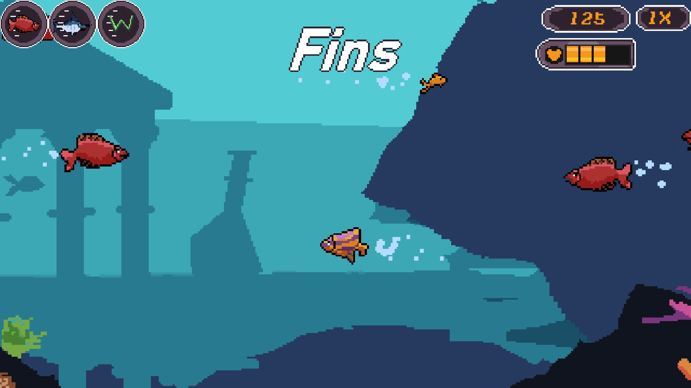

# Hungry Fins

Hungry Fins is a 2D arcade game built with Python and Pygame, inspired by the classic *Feeding Frenzy*.

Eat smaller fish, avoid larger predators, and grow as you make your way through the underwater food chain. The game features multiple fish types, growth stages, combo scoring, and level-based progression, wrapped in a pixel-art style.

## Gameplay

<p align="center">
  
</p>


## Features

- **Fish Growth:** Progress through different growth stages by eating other fish.
- **Different Fish Types:** Encounter fish with different sizes, movement speeds, and behaviors.
- **Combo System:** Chain consecutive eating actions to increase your score multiplier.
- **Level Progression:** Play through levels with configurable gameplay settings.
- **Save Slots:** Keep track of game progress across save slots.
- **Pixel Art:** A 2D visual style designed around the underwater setting.

## Built With

- Python
- Pygame Community Edition (pygame-ce)
- JSON

## Running the Game

### Requirements

- Python 3.10+
- `pygame-ce`
- Pillow

### Setup

```bash
git clone https://github.com/mohamedalaa516/Hungry-Fins.git
cd Hungry-Fins

python -m pip install pygame-ce Pillow
python main.py
```

## Development

Hungry Fins is an ongoing project. The game is being developed in Python using Pygame, with a focus on gameplay mechanics, level progression, and presentation.

## License

See the [LICENSE](LICENSE) file for licensing information.

## Repository

[github.com/mohamedalaa516/Hungry-Fins](https://github.com/mohamedalaa516/Hungry-Fins)
